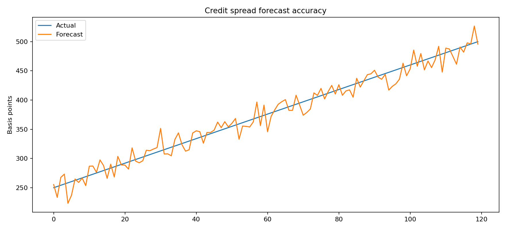
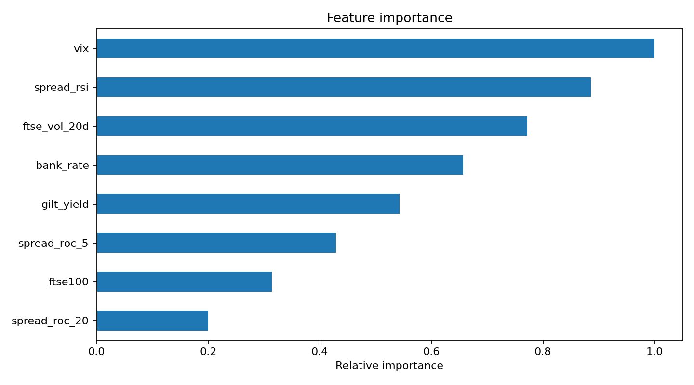

# Credit Spread Forecaster

## Objective

Credit spreads are an early-warning indicator for funding stress, liquidity repricing and portfolio losses. This project turns Bank of England, FTSE, VIX and public credit-spread observations into a reproducible next-period forecast for scenario analysis, risk appetite monitoring and investment-committee discussion. The emphasis is on time-aware modelling and interpretable market signals rather than a single headline score.

## Architecture

```text
Credit-Spread-Forecaster/
├── assets/
│   └── charts/                         # Forecast and importance visuals
├── data/                               # Market inputs and model artefacts
├── docs/
│   └── Credit_Spread_Forecasting_technical_guide.md
├── notebooks/
│   └── credit_spread_forecasting.ipynb
├── src/
│   ├── data_pipeline.py                # BoE, FTSE, FRED and VIX ingestion
│   ├── features.py                     # Volatility, momentum and lag signals
│   ├── train.py                        # Time-ordered model training
│   ├── predict.py                      # Forecast generation
│   └── generate_charts.py              # Evaluation and importance charts
└── tests/
```

## Quickstart

```bash
pip install -r requirements.txt
python -m src.train --config data_paths.txt --output data/model.pkl
python -m src.predict --config data_paths.txt --model data/model.pkl
python -m src.generate_charts
```

### Forecast evidence



The forecast-versus-actuals view is the primary temporal validation artefact. It makes regime changes, calibration drift and potential leakage visible, allowing model owners to distinguish a genuine market shock from deterioration in forecast reliability before the signal is used in planning.



Feature importance provides an explainability bridge between model output and market intuition. VIX, realised FTSE volatility, spread momentum and policy rates reveal whether the forecast is responding to global risk, UK-specific conditions or transient statistical noise.
